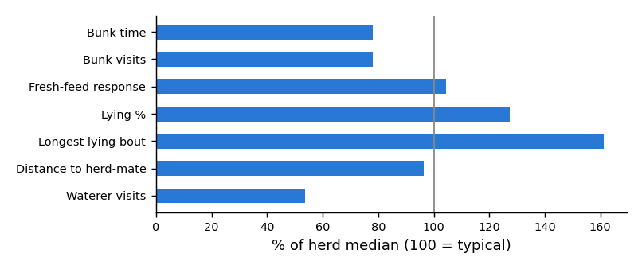
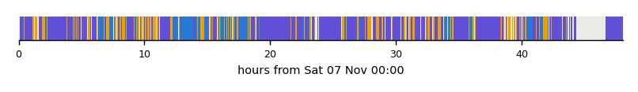

# Risk card: Cow03

**BRD risk score 0.82** (rank 3 of 10; 0.5 = herd-typical) · data reliability: **good** (42 h observed across both days, mean label confidence 0.89)

**Why she is flagged (behaviour observed by the cameras, compared with her 9 pen-mates):**

- change in bunk time from Day 1 to Day 2 lower than herd (-61 vs median -36 % change)
- longest uninterrupted lying bout higher than herd (130 vs median 80 min)
- time at the feed bunk lower than herd (225 vs median 288 min/obs-day)

**48-hour activity** (purple = lying, blue = feeding, yellow = standing, aqua = drinking, grey = not visible):

**Visible clinical signs (agent check on best close-up, estimated):** **not run**: the agent API was unavailable (account credit exhausted) during the final run. Re-run `python -m pipeline.evidence --run full --top 3` to add it.

**How to find her in the pen** (her marks at the time of each clip, from the agent's roll call within 1 h; IDs are reliable for about an hour, see README > Validation): red, white ear tag; no white face; black, at fence; red tag plus small white button in ear; neighbour has blue tag (agent roll call Sat 07:00); red, white ear tag; no white face; lying; pink tag in left ear, small white tag/button in right ear; solid black, muddy legs (agent roll call Sun 13:32); ear tag not visible; no white face; black, head visible facing right by fence post; brownish tint; smaller (agent roll call Sun 16:30)

**Video evidence:**

- [Cow03_1_Cam03_1107_072731.mp4](../../evidence_clips/Cow03_1_Cam03_1107_072731.mp4): after a feed delivery (Sat 07:16) the pipeline labels 71% of visible pen-mates as feeding (mostly seen on the bunk cameras, Cam 02/01) while Cow03 is standing (wide Cam 03 view). Cam 03, Sat 07 Nov 07:27:31
- [Cow03_2_Cam03_1108_131714.mp4](../../evidence_clips/Cow03_2_Cam03_1108_131714.mp4): lying bout of 120 min (Sun 12:18-14:17); 100% of visible pen-mates were also lying then (herd rest period: weak evidence on its own). Cam 03, Sun 08 Nov 13:17:14
- [Cow03_3_Cam02_1108_162558.mp4](../../evidence_clips/Cow03_3_Cam02_1108_162558.mp4): best close-up (used for the clinical-sign check). Cam 02, Sun 08 Nov 16:25:58

**Suggested pen-rider action:** pull and examine (rectal temperature ≥ 40.0 °C / 104 °F, respiratory rate and character, nasal and ocular discharge, ear carriage, lung auscultation). Compare with a herd-mate.

_What this card is and is not:_ behaviour is **observed** (YOLO + tracker + agent on hard cases). Identity and minute labels carry error (see README, Validation). The risk score is **estimated** relative to this herd over 2 days. No clinical records were available, so it is a screening flag, not a diagnosis.