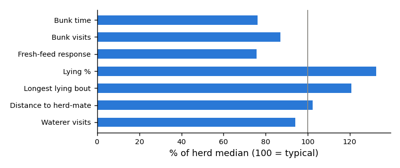
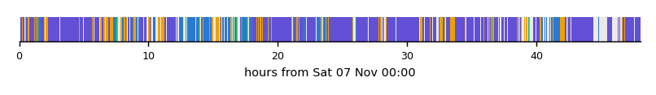

# Risk card: Cow04

**BRD risk score 0.85** (rank 2 of 10; 0.5 = herd-typical) · data reliability: **good** (41 h observed across both days, mean label confidence 0.89)

**Why she is flagged (behaviour observed by the cameras, compared with her 9 pen-mates):**

- change in bunk time from Day 1 to Day 2 lower than herd (-70 vs median -36 % change)
- response to fresh feed (bunk attendance in the 30 min after delivery) lower than herd (39 vs median 51 % of minutes)
- time at the feed bunk lower than herd (220 vs median 288 min/obs-day)

**48-hour activity** (purple = lying, blue = feeding, yellow = standing, aqua = drinking, grey = not visible):

**Visible clinical signs (agent check on best close-up, estimated):** **not run**: the agent API was unavailable (account credit exhausted) during the final run. Re-run `python -m pipeline.evidence --run full --top 3` to add it.

**How to find her in the pen** (her marks at the time of each clip, from the agent's roll call within 1 h; IDs are reliable for about an hour, see README > Validation): ear tag not visible; face not visible; brownish-black coat, small white spots on side/flank (possibly scars or debris), head in shadow by yellow feeder (agent roll call Sat 07:30); red ear tag; no white face; lying down; brownish-black coat; pink tag in left ear (agent roll call Sun 16:01)

**Video evidence:**

- [Cow04_1_Cam03_1107_072601.mp4](../../evidence_clips/Cow04_1_Cam03_1107_072601.mp4): after a feed delivery (Sat 07:16) the pipeline labels 80% of visible pen-mates as feeding (mostly seen on the bunk cameras, Cam 02/01) while Cow04 is standing (wide Cam 03 view). Cam 03, Sat 07 Nov 07:26:01
- [Cow04_2_Cam02_1108_163933.mp4](../../evidence_clips/Cow04_2_Cam02_1108_163933.mp4): best close-up (used for the clinical-sign check). Cam 02, Sun 08 Nov 16:39:33

**Suggested pen-rider action:** pull and examine (rectal temperature ≥ 40.0 °C / 104 °F, respiratory rate and character, nasal and ocular discharge, ear carriage, lung auscultation). Compare with a herd-mate.

_What this card is and is not:_ behaviour is **observed** (YOLO + tracker + agent on hard cases). Identity and minute labels carry error (see README, Validation). The risk score is **estimated** relative to this herd over 2 days. No clinical records were available, so it is a screening flag, not a diagnosis.